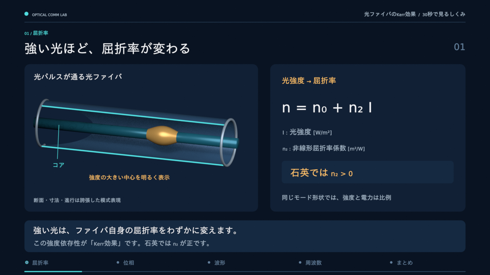

# 光ファイバのKerr効果

[動画（MP4、30秒）](kerr_effect.mp4) · [編集用Blenderシーン](kerr_effect.blend) · [再現記録](manifest.json)

[](kerr_effect.mp4)

強い光が屈折率を変え、強度に応じた位相の回転が積み重なり、周波数成分が広がり得る過程を、日本語字幕で説明する。1280×720、24 fps、音声なし。3Dのファイバは断面・寸法・進行を誇張した模式図で、実際の伝搬速度を表していない。

| 時間 | 内容 |
| --- | --- |
| 0–6秒 | 強度依存の屈折率 `n = n0 + n2 I`。石英では `n2 > 0` |
| 6–12秒 | 強度の山に対応して非線形位相が蓄積する。3つの位相ベクトルで比較 |
| 12–18秒 | 入出力の電場と同じ包絡線を比較。搬送波の周期は見えるように拡大 |
| 18–24秒 | 位相の時間微分によるチャープと、同じエネルギーでのスペクトル比較 |
| 24–30秒 | 因果関係のまとめと、この模式例の適用範囲 |

式は単一偏波・無損失・無分散の解析例で、`P/P0 = exp(−τ²)`、`τ=t/T0`、最終的な位相の頂点は3 rad。距離に対応する進行率 `u=L/L0` に対して `φ_NL=3u exp(−τ²)=γLP(t)` とする。`P0` と `T0` は正規化の基準で、研究runの電力やパルス幅ではない。強度 `I` の単位は W/m²、電力 `P` は W、`γ` は 1/(W·km)、`L` は km。同じ有効モードで `γ=k0 n2/A_eff` として強度の説明から電力の式へ移る。

`A_out = A_in exp(iφ_NL)` なので、純粋なKerr作用では `|A_out|²=|A_in|²`。包絡線の時間幅が広がったり、振幅ノイズが取り除かれたりする作用は示していない。電場の規約を `E=Re{A exp[i(kz−ω0t)]}` とし、周波数差は `Δω=−dφ_NL/dt`。正のKerr応答ではパルス前半が低い周波数、後半が高い周波数にずれる。スペクトルは解析場のFFTで、入力のピークを共通の縦軸基準にする。描画用の17段階の位相スナップショットだけを補間する。

本repoの1600 km評価は、2偏波のManakovモデル、損失、分散、増幅器ASEを含む。非線形項は `(8/9)γ(Px+Py)` で、この動画のスカラー式とは区別する。この動画は測定・学習・BER評価のデータを使っていない。[通信路の規約](../../../docs/channel-methods.md)と[最終レポート](../../final_report.md)を参照する。

リポジトリ直下から再生成する。Blender 5.2、FFmpeg/FFprobe、日本語フォントIPAexGothic、数式用DejaVu Sansが必要。通常のPythonで起動し、数値・描画処理にはBlender同梱Python/NumPyを使う。科学計算runの再実行は不要。

```bash
python3 scripts/animate_kerr.py --blender blender \
  --font /usr/share/fonts/opentype/ipaexfont-gothic/ipaexg.ttf \
  --latin-font /usr/share/fonts/truetype/dejavu/DejaVuSans.ttf
```

今回のWSL環境ではWindows版Blenderを利用した。

```bash
python3 scripts/animate_kerr.py \
  --blender '/mnt/c/Program Files/Blender Foundation/Blender 5.2/blender.exe' \
  --font /usr/share/fonts/opentype/ipaexfont-gothic/ipaexg.ttf \
  --latin-font /usr/share/fonts/truetype/dejavu/DejaVuSans.ttf
```

`--preview` を追加すると、章ごとの6枚の静止画と2秒の試し動画を `.work/kerr-render/` に保存する。`--build-only` はシーンだけ保存する。全720枚の中間PNGとログも `.work/` に置く。出力先は `--output-dir`、一時出力先は `--scratch-dir` で変更できる。

シーンをBlenderで開けば、5章のCollection、タイムラインの章マーカー、テキスト、曲線、位相コントローラの `phase_rad` を編集できる。外部Pythonハンドラを使わず、キーフレーム・ドライバ・シェイプキーで動く。フォント2種を変更せずシーンへ格納し、[ライセンス全文](LICENSE-fonts.txt)を添付した。版・正確な実行コマンド・パラメータ・式の通常検証・動画仕様・入力と出力のSHA-256は [manifest.json](manifest.json) にある。GPU、Blender、エンコーダの差によりピクセルやMP4のバイト列は変わり得る。

出典は、石英ファイバのSPMとスペクトル広がりを測定した [Stolen & Lin (1978)](https://doi.org/10.1103/PhysRevA.17.1448)、強度依存の屈折率表現を使う [Arroyo Meza et al. (2013)](https://doi.org/10.1103/PhysRevE.88.053202)、時間ごとの周波数変化を測定した [Hamaide & Emplit (1989)](https://doi.org/10.1364/OL.14.000689)。最後の実験には分散・Ramanも含まれ、純粋SPMの較正値としては使っていない。
