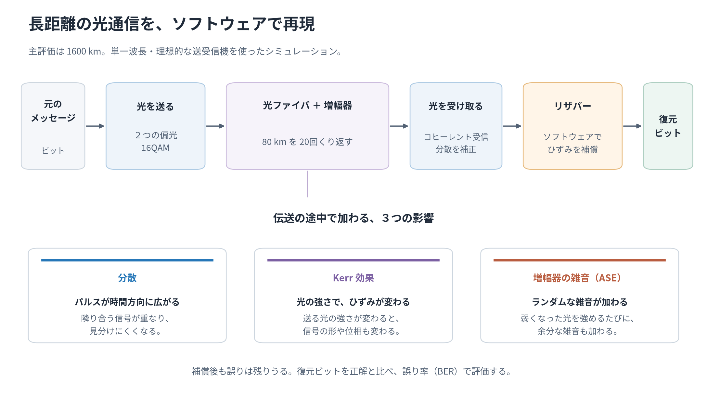
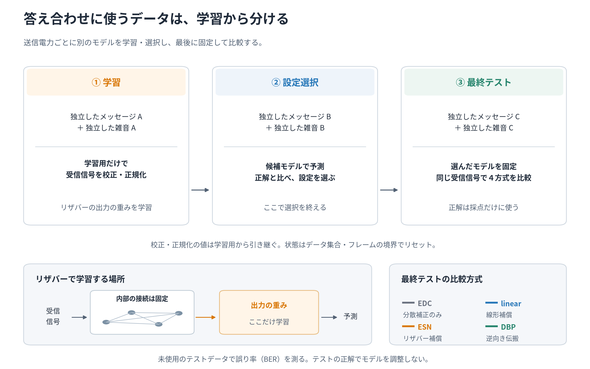
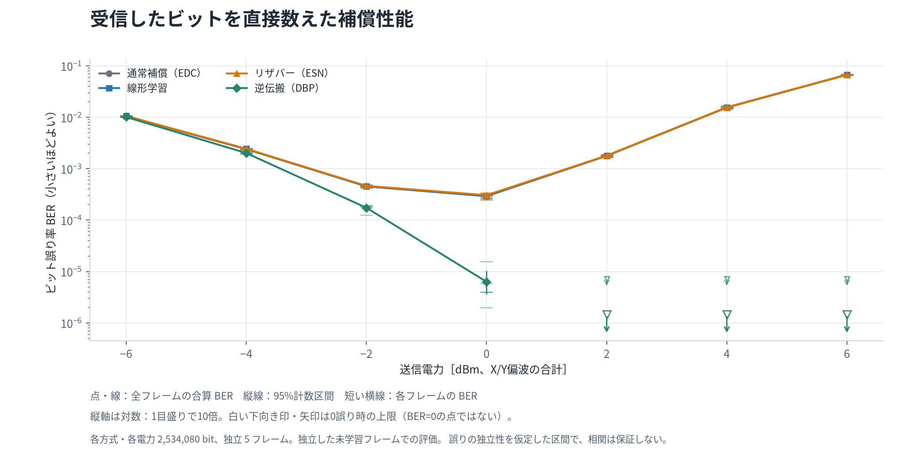
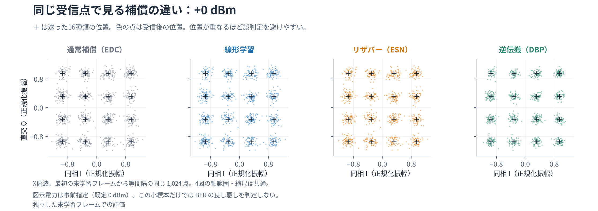
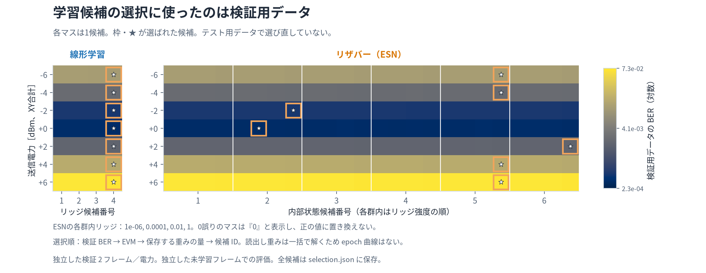
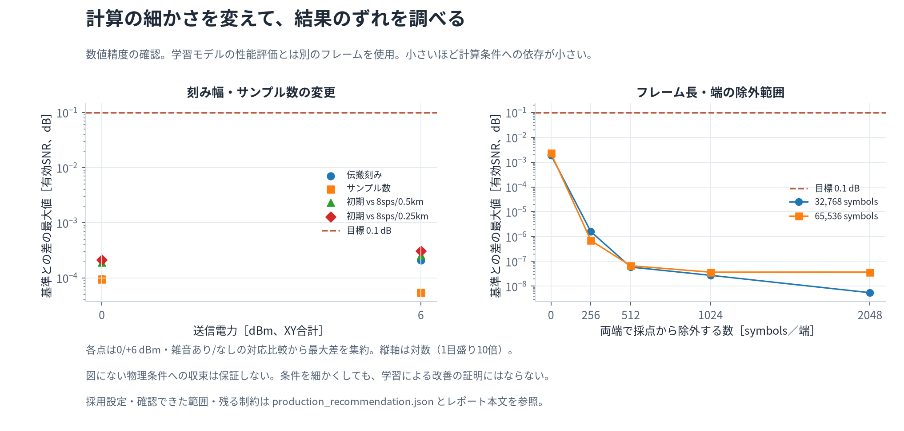
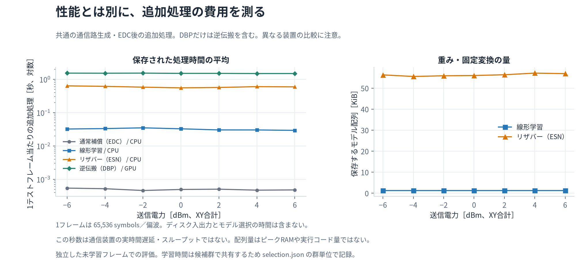

# 光ファイバ長距離伝送をリザバーで補償できるか

今回の数値シミュレーションでは、リザバー補償のビット誤り率（BER）が7つの送信電力すべてで通常補償より高かった。モデルの学習は完了したが、通信品質の改善は確認できなかった。

BERは『間違って受信したビット数 ÷ 調べたビット数』。小さいほどよい。今回の結果は誤り訂正（FEC）を行う前の値である。

| +0 dBmでの比較 | 誤り数 / 調べたビット数 | BER |
| --- | --- | --- |
| 通常補償（EDC） | 738 / 2,534,080 | 2.91e-04 |
| リザバー（ESN） | 775 / 2,534,080 | 3.06e-04 |

同じ受信信号・同じ採点区間を比較した。各電力では、独立に作った5テストフレーム、各方式 2,534,080 bit を調べた。実機の伝送実験ではなく、ソフトウェア上の数値シミュレーションである。

## 何を測ったか

16種類の点の位置でビットを表す光信号を、増幅器をはさんだ光ファイバに通した。伝送中の広がり、光の強さに依存するひずみ、増幅器が足す雑音を再現し、受信側の4方式を比べた。DBPは物理計算を逆向きに解く比較対象で、雑音を消せる理想的な上限とは仮定していない。

| 項目 | 今回の範囲 |
| --- | --- |
| 伝送 | 1600 km（20 × 80 km）、単一波長・2偏波、16QAM・32 GBd |
| 送信電力 | -6、-4、-2、+0、+2、+4、+6 dBm（X/Y偏波の合計） |
| データ | 電力ごとに独立フレーム：学習 2、候補選択 2、テスト 5 |
| 送受信器 | 理想的な同期。実機の位相ずれ、量子化、多波長間の干渉などは含まない |



図1　通信路と4方式の説明図。測定値ではない。同じ伝送結果・同じ採点区間で比べた。

リザバー（ESN）は過去の入力を内部状態に残すモデルで、今回は128状態を使った。内部の接続は固定し、受信点を送信点へ近づける出口の重みだけを学習した。線形方式とは同じ明示的な入力窓を使うが、ESNは内部状態にも過去の履歴を保持する。



図2　学習・候補選択・最終評価の分離。校正と入力の尺度は学習データだけから決め、テストを見る前にモデルを固定した。説明図であり、性能の測定値ではない。

## 結果の意味



図3　全電力条件のBER。点は全フレームの合算、縦線は95%計数区間、短い横線は各独立フレーム。縦軸は対数で1目盛りが10倍。0誤りは上限からの下向き矢印で示す。

95%区間は各ビットの誤りが独立という仮定に基づき、連続する誤りをすべて扱うものではない。このため独立フレーム間のばらつきも示した。区間の重なりだけで方式間の有意差を断定していない。

DBPの +2 dBm、+4 dBm、+6 dBm では0誤りだったが、有限の評価数に対する95%上限は 1.46e-06。雑音を完全に消した、将来も誤らない、という意味ではない。

| 電力 [dBm] | 通常補償 BER [誤り数] | 線形方式 BER [誤り数] | ESN BER [誤り数] | DBP BER [誤り数] |
| --- | --- | --- | --- | --- |
| -6 | 1.04e-02 [26,462] | 1.06e-02 [26,837] | 1.06e-02 [26,879] | 1.01e-02 [25,638] |
| -4 | 2.39e-03 [6,051] | 2.43e-03 [6,160] | 2.44e-03 [6,171] | 2.01e-03 [5,100] |
| -2 | 4.54e-04 [1,151] | 4.51e-04 [1,143] | 4.63e-04 [1,174] | 1.74e-04 [440] |
| +0 | 2.91e-04 [738] | 2.94e-04 [746] | 3.06e-04 [775] | 6.31e-06 [16] |
| +2 | 1.77e-03 [4,489] | 1.80e-03 [4,550] | 1.80e-03 [4,549] | 0（95%上限 1.46e-06） [0] |
| +4 | 1.54e-02 [39,027] | 1.56e-02 [39,525] | 1.56e-02 [39,599] | 0（95%上限 1.46e-06） [0] |
| +6 | 6.67e-02 [169,021] | 6.75e-02 [171,068] | 6.76e-02 [171,403] | 0（95%上限 1.46e-06） [0] |

各方式・各電力の評価数は 2,534,080 bit。7電力すべてを表示し、結果のよい条件だけを選んでいない。

同じ明示的な入力窓を使う線形方式に対しても、ESNのBERが低かったのは+2 dBmだけで、誤り数 4,549 対 4,550（1個の差）だった。この結果だけでESNの優位性は判断できない。



図4　事前指定の+0 dBm、X偏波の同じ1,024点。十字は送信位置、色点は受信結果。最初のテストフレームから等間隔に保存した点を、共通の軸で表示した。

この電力で、送信点からの相対的なずれ（EVM）は通常補償 12.95%、ESN 12.84%。EVMは小さいほど点に近いが、通信品質は実際の誤り数で判断する。

今回は平均的なずれが少し小さくても、誤りは 738 個から 775 個へ増えた。EVMの改善だけではBERの改善を証明できない。配置図の小標本だけでも優劣を決めない。

## 限界と次の問い

- 各電力で別モデルを学習した。未学習の電力・距離への適用や、実機・多波長伝送・誤り訂正後の性能は検証していない。
- 独立フレームのばらつきは確認したが、リザバーの初期化は各電力1通り。今回の結果を、リザバー全般の頑健性や性能の結論には広げない。
- 改善が得られなかった原因はこの比較だけでは特定できない。次は内部重みを別に初期化し、新しい独立データでも今回の結果が再現するかを調べる。

実験条件と方法： [実験計画](../docs/experiment-plan.md) / [通信路](../docs/channel-methods.md) / [学習と評価](../docs/learning-methods.md)。

## 技術補足

必要な項目を開いて読める。印刷するときは、含めたい補足を開いてから印刷する。

<details><summary>補足1：実装条件と、検証データでの候補選択</summary>

| 項目 | 保存した設定 |
| --- | --- |
| ファイバ・増幅器 | 損失 0.2 dB/km、分散 17 ps/(nm km)、非線形係数 1.3 /(W km)、雑音指数 5 dB |
| 数値計算 | 4 samples/symbol、伝搬刻み 1 km、DBP刻み 1 km、倍精度 |
| 波形・境界 | RRC roll-off 0.1、65,536 symbols/偏波、両端 1,024 symbolsを採点から除外 |
| 入力窓と状態 | 前4・後4 symbols。ESNは内部状態にも履歴を保持し、フレームごとにリセット。立上り 128 symbolsを除外 |
| 端末 | 理想同期。レーザー位相雑音、周波数ずれ、PMD、量子化、多波長干渉は含まない |



図5　すべての候補の検証BER。枠と星が選択結果。BER、EVM、保存配列量、候補IDの順で決め、テストで選び直していない。読出しはリッジ回帰で一括計算するためepoch曲線はない。

電力ごとにESN 24候補、線形方式 4候補を比較。校正と正規化は学習フレームだけで決めた。モデルの保存・復元後も検証フレームへの予測が完全一致した。候補と選択IDは各電力の selection.json に保存している。

</details>

<details><summary>補足2：学習性能とは別に行った数値条件の確認</summary>

刻み幅・サンプル数・フレーム長・境界の除外数を別々に変えた。目標は有効SNR差0.1 dB以内とBERの統計的整合性。計算条件への依存を調べる確認で、ESNの改善を示す証拠ではない。



図6　計算条件変更による有効SNRの最大差。破線は0.1 dBの目標。BERの整合性も含めて確認した。学習モデルのテストとは別のデータである。

| 確認の対象 | 条件ごとの比較数 | 有効SNR差の最大値 | 目標 |
| --- | --- | --- | --- |
| 刻み幅・サンプル数 | 28 | 0.00031 dB | 0.1 dB以内 + BER整合 |
| フレーム長・境界除外 | 40 | 0.0023 dB | 0.1 dB以内 + BER整合 |

初期の4 samples/symbol・1 km刻み・256 symbols除外も基準内だった。境界に対する測定上の余裕を確保するため、最終評価は1024 symbols除外を採用した。

雑音だけを加えた3条件でも、実測BERは独立に求めた16QAM理論値と事前指定の99.9%計数区間内で整合し、有効SNR差は0.1 dB以内だった。

数値確認は0/+6 dBmの代表2電力と有限の比較に限る。伝搬波形に非ゼロの差が残り、受信指標の安定性を確認した。短い雑音波形の境界確認は、長い波形の同じ先頭部分を切り出して行った。すべての電力や連続方程式の厳密解を証明するものではない。

精密な値・比較条件・限界： [数値確認の記録](../artifacts/numerical-qualification/production_recommendation.json) / [数値確認の方法](../docs/numerical-qualification.md)。

</details>

<details><summary>補足3：実装に依存する追加処理時間と保存重み</summary>



図7　共通の通信路生成・EDC後の追加処理時間とモデル配列量。DBPは逆伝搬を含む。線形方式/ESNはCPU、CuPy使用時のDBPはGPU。時間は1テストフレームの平均で、入出力と候補選択を含まない。

実行装置：AMD Ryzen 7 9700X（ESN・線形方式）、NVIDIA GeForce RTX 5060 Ti（通信路・DBP）、Linux on Microsoft WSL。異なる装置・処理範囲の測定なので、実機の遅延・消費電力・スループットや理論的な計算量の優劣を示すものではない。配列量はピークRAMではない。

| +0 dBmでの方式 | BER | 誤り数 / bit数 | EVM | 追加時間 / frame | モデル配列 |
| --- | --- | --- | --- | --- | --- |
| 通常補償（EDC） | 2.91e-04 | 738 / 2,534,080 | 12.95% | 0.493 ms | 0.03 KiB |
| 線形学習 | 2.94e-04 | 746 / 2,534,080 | 12.86% | 32.6 ms | 1.25 KiB |
| リザバー（ESN） | 3.06e-04 | 775 / 2,534,080 | 12.84% | 0.553 s | 55.99 KiB |
| 逆伝搬（DBP） | 6.31e-06 | 16 / 2,534,080 | 10.17% | 1.5 s | 0.03 KiB |

通常補償とDBPの配列量は校正係数だけで32 bytes。実行コードや作業メモリを含まない。線形/ESNは model_array_bytes を使い、圧縮checkpointのファイルサイズとは分けた。

入力窓は未来の4シンボルも参照し、入力待ちだけで 125 ps が必要。フレームの蓄積、EDC、計算、装置の遅延を含まない。

装置・ドライバ・実際のthread環境： [execution-hardware.json](../artifacts/final-1600km-20261012/execution-hardware.json)。

</details>

<details><summary>補足4：再現コマンド、元データ、通常検証・独立評価</summary>

実行ID：final-1600km-20261012。全候補、校正値、bit/ASEの種、モデル、ソフトウェア版とハッシュを保存した。大きな生波形はレシピから再生成する。pilotは最終BERに合算していない。

元データと図の来歴： [summary.csv](../artifacts/final-1600km-20261012/summary.csv) / [config.json](../artifacts/final-1600km-20261012/config.json) / [manifest.json](../artifacts/final-1600km-20261012/manifest.json) / [結果図の入力・出力ハッシュ](figures/results_manifest.json)。

```bash
uv sync --python 3.12 --locked --group dev --extra gpu  # CUDA準備はREADMEを参照
.venv/bin/python -m pytest
.venv/bin/python scripts/run_experiment.py --config artifacts/final-1600km-20261012/config.json --run-id final-reproduction
.venv/bin/python scripts/visualize_results.py --run artifacts/final-1600km-20261012 --qualification artifacts/numerical-qualification --output-dir reports/figures --constellation-power 0 --dpi 180 --format svg png
.venv/bin/python scripts/build_report.py --run artifacts/final-1600km-20261012 --figures-dir reports/figures --output-dir reports --qualification artifacts/numerical-qualification --review-record artifacts/verification/independent_review.json --verification-record artifacts/verification/ordinary_checks.json
```

HTMLは全7図を埋め込み、ネット接続なしで読める。図は保存結果から生成し、結果の置換や都合のよい条件・受信点の選別をしていない。

統合通常テスト52件が成功。物理解析極限、AWGN理論、CPU/GPU一致、データ分離、モデル保存・再読込、数値資格確認、および保存runの監査・改変検出を検証した。数値資格確認では距離刻み・サンプリング数の28集計とフレーム長・境界の40集計が基準内。追跡済みファイルだけをコピーした環境で補助監査も成功した。

通常検証： [ordinary_checks.json](../artifacts/verification/ordinary_checks.json)。

独立評価：指定1回、試行0回、完了0回。通常検証と最終成果物を揃えた後、独立validatorを1回実施する。現在は未実施。 親の実効設定OpenAI/gpt-6-astra/maxを確認済み。起動時に同じ設定と実効情報を確認する。

独立評価の原記録と親による対応： [評価・対応記録](../artifacts/verification/independent_review.json)。

</details>

研究設計・開発管理： [元の要件](../docs/requirements.md) / [Issue #6](https://github.com/Motoki0705/optical-comm-lab/issues/6) / [統合PR #7](https://github.com/Motoki0705/optical-comm-lab/pull/7) / [scoutによる保守点検](../docs/repository-maintenance.md) / [AGENTS.md](../AGENTS.md)。

基礎資料： [OptiCommPy Manakov](https://opticommpy.readthedocs.io/en/latest/generated/optic.models.channels.manakovSSF.html) / [EDFA](https://opticommpy.readthedocs.io/en/latest/generated/optic.models.devices.edfa.html) / [DBP：Ip・Kahn（2008）](https://www-ee.stanford.edu/~jmk/pubs/digital.backpropagation.jlt.10-08.pdf) / [学習評価の注意：Freireら](https://arxiv.org/html/2109.14942)。
