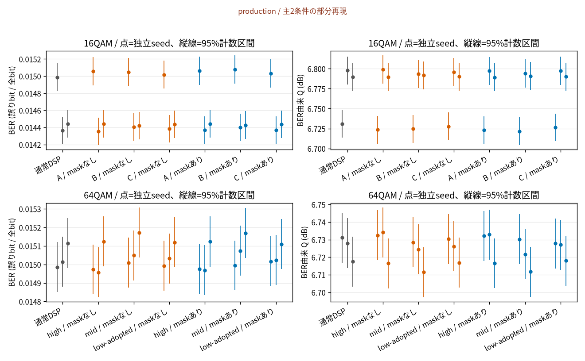
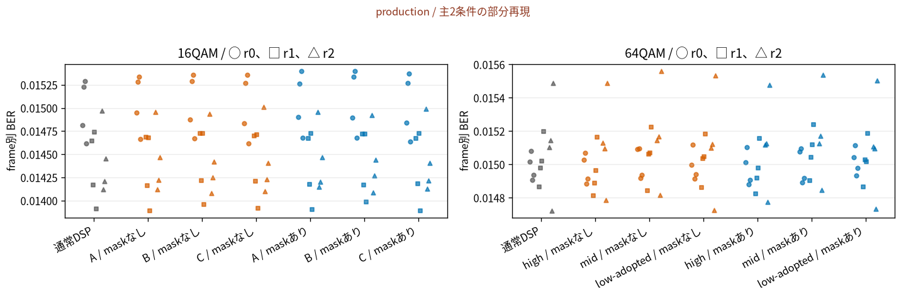
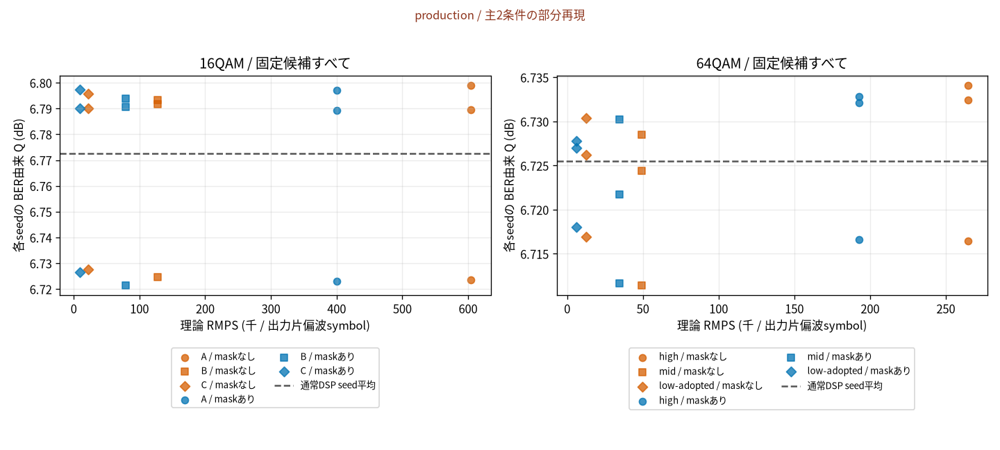
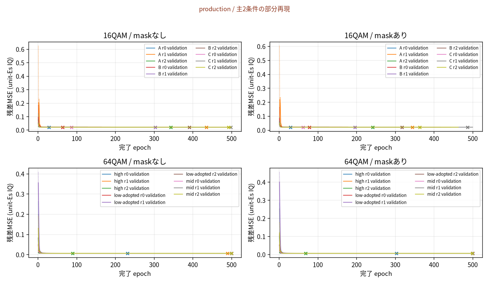
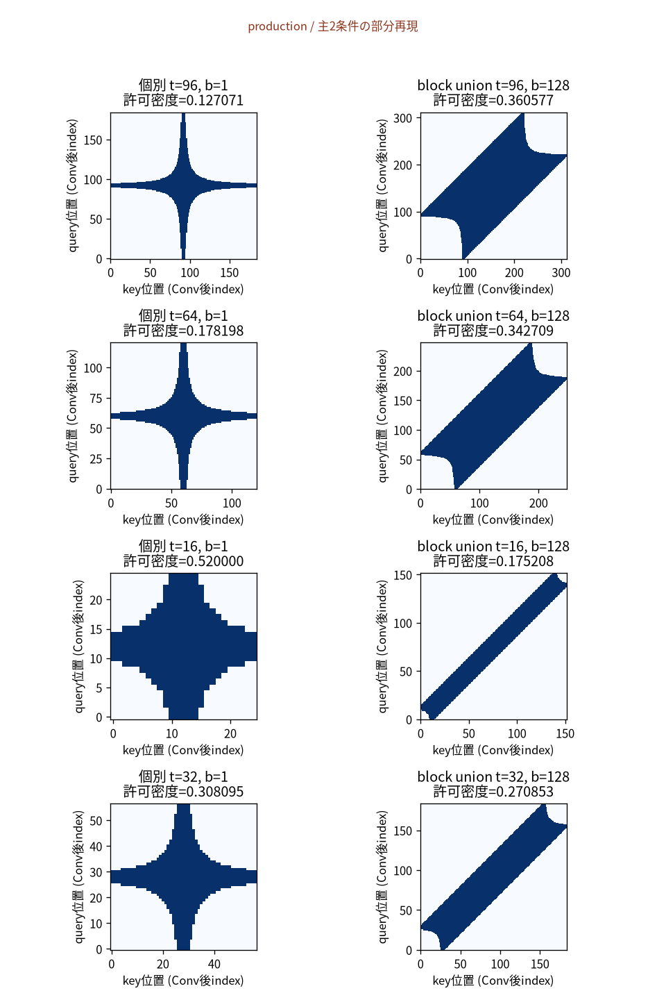

# Transformerで光通信の誤りを減らせたか

production / 主2条件の部分再現

16QAMは1偏波の1記号に4 bit、64QAMは6 bitを載せる方式です。2つの偏波X/Yを同時に送ります。長い光ファイバでは雑音と光強度に依存するKerr効果で受信点がずれます。通常DSPは分散や位相などを補正する受信処理、NLCはその後に残るずれを学習モデルで推定し、引き算する補償です。残差には雑音も含まれ、純粋なKerr効果だけを測っているわけではありません。

| 判断の対象 | 保存された証拠と状態 |
| --- | --- |
| 学習・固定・評価の完了 | 学習 36/36 run、評価 36/36 run。評価status=complete |
| 数値資格 | 16QAM r0: passed; 16QAM r1: passed; 16QAM r2: passed; 64QAM r0: passed; 64QAM r1: passed; 64QAM r2: passed |
| 独立bit再計数 | 評価時=passed、今回=未再実行（保存済み証拠を参照） |
| 論文再現の分類 | 主2条件の部分再現。Qが近くても原論文全体の厳密再現成功とはしない。一致の合否は根拠ある数値許容幅がないため未確定。 |
| 独立validator | 指定 / 試行 / 完了 = 0 / 0 / 0。この報告生成は独立評価ではない。 |

## どの条件を測ったか

| 条件 | 距離 | 伝送速度 / power | train / validation / test | 数値設定 |
| --- | --- | --- | --- | --- |
| 16QAM r0 | 40×80 = 3200 km | 32 GBd / 2 dBm (XY合計) | 8 / 2 / 4 × 65536 DP時刻 | 4 sps / 0.05° / guard 4096 / RRC 128 |
| 16QAM r1 | 40×80 = 3200 km | 32 GBd / 2 dBm (XY合計) | 8 / 2 / 4 × 65536 DP時刻 | 4 sps / 0.05° / guard 4096 / RRC 128 |
| 16QAM r2 | 40×80 = 3200 km | 32 GBd / 2 dBm (XY合計) | 8 / 2 / 4 × 65536 DP時刻 | 4 sps / 0.05° / guard 4096 / RRC 128 |
| 64QAM r0 | 12×80 = 960 km | 42 GBd / 3 dBm (XY合計) | 8 / 2 / 4 × 65536 DP時刻 | 4 sps / 0.05° / guard 4096 / RRC 128 |
| 64QAM r1 | 12×80 = 960 km | 42 GBd / 3 dBm (XY合計) | 8 / 2 / 4 × 65536 DP時刻 | 4 sps / 0.05° / guard 4096 / RRC 128 |
| 64QAM r2 | 12×80 = 960 km | 42 GBd / 3 dBm (XY合計) | 8 / 2 / 4 × 65536 DP時刻 | 4 sps / 0.05° / guard 4096 / RRC 128 |

| 条件 | 通常DSPの固定値 | normalization / testラベル |
| --- | --- | --- |
| 16QAM r0 | FIR 11 taps / BPS window 65 / phases 64 | 既知XY power→unit-Es、専用pilot校正。test scored labelsでfitしない |
| 16QAM r1 | FIR 11 taps / BPS window 65 / phases 64 | 既知XY power→unit-Es、専用pilot校正。test scored labelsでfitしない |
| 16QAM r2 | FIR 11 taps / BPS window 65 / phases 64 | 既知XY power→unit-Es、専用pilot校正。test scored labelsでfitしない |
| 64QAM r0 | FIR 11 taps / BPS window 65 / phases 64 | 既知XY power→unit-Es、専用pilot校正。test scored labelsでfitしない |
| 64QAM r1 | FIR 11 taps / BPS window 65 / phases 64 | 既知XY power→unit-Es、専用pilot校正。test scored labelsでfitしない |
| 64QAM r2 | FIR 11 taps / BPS window 65 / phases 64 | 既知XY power→unit-Es、専用pilot校正。test scored labelsでfitしない |

| 項目 | 原論文と今回の扱い |
| --- | --- |
| published | 主16QAM 3200 km・32 GBd、主64QAM 960 km・42 GBd、NF6 dB、roll-off1/16、半量Tx分散事前補償 |
| adopted | loss0.2 dB/km、D17 ps/(nm km)、gamma1.3 /(W km)、1550 nm、PMD/linewidth0、固定128 GHz ASE band、pilotによるFIR/CR、追加validation、BER由来Q |
| author_tex_commented | 代表構造との対応は公式TeXコメントに依存。公開本文で確認された実行configではない。64QAM low-adoptedはt8からt16に変更。 |
| unresolved | 原実装のDSP、key size解釈、mask密度、Fig.8色、Q定義、RMPSの全算入規則との同一性は未確定。 |

## 誤り率と通信品質

BERは誤りbit数/全bit数で、小さいほど良い値です。QはBERを非線形変換したdB値で、大きいほど良い値です。表のQ合算は全seedのbitを合算したBERからの変換で、seed Qの平均とは異なります。95%計数区間は独立bitを仮定するClopper–Pearson区間で、相関した誤りやseed間の不確かさを包含しません。



全候補と通常DSP。各点はseed全frameの合算。縦線はClopper–Pearson 95%計数区間で、seed間の信頼区間ではない。ゼロ誤りではBER上限▽とQ下限△を示す。

| 条件 / 手法 | seed | errors / bits（重複なし） | 合算BER [95%計数区間] | 合算Q [95%計数区間] dB | seed Q平均 ± 標本SD dB |
| --- | --- | --- | --- | --- | --- |
| 16QAM / 通常DSP | [0, 1, 2] | 91839 / 6291456 | 0.0146 [0.0145, 0.01469] | 6.772 [6.762, 6.783] | 6.773 ± 0.03639 |
| 16QAM / A / maskなし | [0, 1, 2] | 91960 / 6291456 | 0.01462 [0.01452, 0.01471] | 6.77 [6.76, 6.781] | 6.771 ± 0.0411 |
| 16QAM / B / maskなし | [0, 1, 2] | 92004 / 6291456 | 0.01462 [0.01453, 0.01472] | 6.77 [6.76, 6.78] | 6.77 ± 0.03921 |
| 16QAM / C / maskなし | [0, 1, 2] | 91934 / 6291456 | 0.01461 [0.01452, 0.01471] | 6.771 [6.761, 6.781] | 6.771 ± 0.03776 |
| 16QAM / A / maskあり | [0, 1, 2] | 92007 / 6291456 | 0.01462 [0.01453, 0.01472] | 6.77 [6.76, 6.78] | 6.77 ± 0.04067 |
| 16QAM / B / maskあり | [0, 1, 2] | 92073 / 6291456 | 0.01463 [0.01454, 0.01473] | 6.768 [6.758, 6.779] | 6.769 ± 0.04092 |
| 16QAM / C / maskあり | [0, 1, 2] | 91925 / 6291456 | 0.01461 [0.01452, 0.01471] | 6.771 [6.761, 6.781] | 6.771 ± 0.03901 |
| 64QAM / 通常DSP | [0, 1, 2] | 141917 / 9437184 | 0.01504 [0.01496, 0.01512] | 6.726 [6.717, 6.734] | 6.726 ± 0.007116 |
| 64QAM / high / maskなし | [0, 1, 2] | 141727 / 9437184 | 0.01502 [0.01494, 0.0151] | 6.728 [6.719, 6.736] | 6.728 ± 0.009724 |
| 64QAM / mid / maskなし | [0, 1, 2] | 142283 / 9437184 | 0.01508 [0.015, 0.01515] | 6.721 [6.713, 6.73] | 6.721 ± 0.008909 |
| 64QAM / low-adopted / maskなし | [0, 1, 2] | 142011 / 9437184 | 0.01505 [0.01497, 0.01513] | 6.724 [6.716, 6.733] | 6.724 ± 0.00688 |
| 64QAM / high / maskあり | [0, 1, 2] | 141771 / 9437184 | 0.01502 [0.01495, 0.0151] | 6.727 [6.719, 6.735] | 6.727 ± 0.009182 |
| 64QAM / mid / maskあり | [0, 1, 2] | 142307 / 9437184 | 0.01508 [0.015, 0.01516] | 6.721 [6.713, 6.729] | 6.721 ± 0.009266 |
| 64QAM / low-adopted / maskあり | [0, 1, 2] | 142030 / 9437184 | 0.01505 [0.01497, 0.01513] | 6.724 [6.716, 6.732] | 6.724 ± 0.005428 |

通常DSPはdata manifest・condition・replicate・frameごとに一度だけ計数しました。完全一致した重複frameの除外数=0。本番1 seedの分母は16QAM 2^18×8=2,097,152 bit、64QAM 2^18×12=3,145,728 bitです。pilotの分母をこれらへ拡大していません。X/Y別と全frame/seedの生計数はcounts.csvに保存しました。



1点=独立frame。各seedのframeをすべて示し、相関誤りを含む変動を計数区間と分離する。小fixtureのframe数は本番4とは異なる。

## 全候補の性能と計算量



理論乗算数と保存test性能。点=独立seed、形=候補、色=mask有無。ゼロ誤りはQ下限△。DP時刻の計数は横軸の2倍。maskは疎実装を仮定した計数であり、dense backendの実速度向上を表さない。論文参考点は重ねず別表に示す。

| 条件 / 手法 | 理論RMPS / 片偏波symbol | 理論RMPS / DP時刻 | dense backend推定 / 片偏波symbol | 許可attention密度 |
| --- | --- | --- | --- | --- |
| 16QAM A / maskなし | 6.046e+05 | 1.209e+06 | 6.046e+05 | 1.000000 |
| 16QAM A / maskあり | 4.003e+05 | 8.007e+05 | 6.046e+05 | 0.360577 |
| 16QAM B / maskなし | 1.276e+05 | 2.551e+05 | 1.276e+05 | 1.000000 |
| 16QAM B / maskあり | 7.955e+04 | 1.591e+05 | 1.276e+05 | 0.342709 |
| 16QAM C / maskなし | 2.193e+04 | 4.387e+04 | 2.193e+04 | 1.000000 |
| 16QAM C / maskあり | 8832 | 1.766e+04 | 2.193e+04 | 0.175208 |
| 64QAM high / maskなし | 2.646e+05 | 5.292e+05 | 2.646e+05 | 1.000000 |
| 64QAM high / maskあり | 1.926e+05 | 3.852e+05 | 2.646e+05 | 0.342709 |
| 64QAM mid / maskなし | 4.897e+04 | 9.794e+04 | 4.897e+04 | 1.000000 |
| 64QAM mid / maskあり | 3.431e+04 | 6.863e+04 | 4.897e+04 | 0.270853 |
| 64QAM low-adopted / maskなし | 1.266e+04 | 2.531e+04 | 1.266e+04 | 1.000000 |
| 64QAM low-adopted / maskあり | 6106 | 1.221e+04 | 1.266e+04 | 0.175208 |

RMPSは採用規約による実乗算数の推定です。片偏波出力に対しXYを2回推論するためDP時刻では2倍です。maskありの理論削減は疎な計算を仮定します。実装はdense attention dispatcherを使うため、密度低下から学習時間・速度・VRAMの削減を主張できません。加算、活性化、rsqrt、メモリ移動は計数外で、softmax換算とLayerNormの算入は再現側の規約です。

primaryはtestを開く前にvalidation MSEで選択した候補です。seedの良いものだけを選ぶ操作はしていません。固定された選択: 16QAM maskなし=C、seed=[0, 1, 2]; 16QAM maskあり=C、seed=[0, 1, 2]; 64QAM maskなし=high、seed=[0, 1, 2]; 64QAM maskあり=high、seed=[0, 1, 2]

## 学習はどこで止まったか



全runの曲線。点線=train X、実線=validation XY、×=best-validation epoch。停止理由は全run表に保存。epoch capは収束の証拠ではない。

| 条件 / 候補 / mask / seed | 学習 / test | best / 完了epoch | 停止理由 / 収束 | 失敗・中断attempt |
| --- | --- | --- | --- | --- |
| 16 / A / False / r0 | complete / scored | 28 / 128 | patience / patience | なし |
| 16 / A / False / r1 | complete / scored | 435 / 500 | epoch_cap / not_established | なし |
| 16 / A / False / r2 | complete / scored | 343 / 443 | patience / patience | なし |
| 16 / A / True / r0 | complete / scored | 29 / 129 | patience / patience | なし |
| 16 / A / True / r1 | complete / scored | 344 / 444 | patience / patience | なし |
| 16 / A / True / r2 | complete / scored | 242 / 342 | patience / patience | なし |
| 16 / B / False / r0 | complete / scored | 64 / 164 | patience / patience | なし |
| 16 / B / False / r1 | complete / scored | 303 / 403 | patience / patience | なし |
| 16 / B / False / r2 | complete / scored | 391 / 491 | patience / patience | なし |
| 16 / B / True / r0 | complete / scored | 78 / 178 | patience / patience | なし |
| 16 / B / True / r1 | complete / scored | 196 / 296 | patience / patience | なし |
| 16 / B / True / r2 | complete / scored | 317 / 417 | patience / patience | なし |
| 16 / C / False / r0 | complete / scored | 87 / 187 | patience / patience | なし |
| 16 / C / False / r1 | complete / scored | 498 / 500 | epoch_cap / not_established | なし |
| 16 / C / False / r2 | complete / scored | 492 / 500 | epoch_cap / not_established | なし |
| 16 / C / True / r0 | complete / scored | 62 / 162 | patience / patience | なし |
| 16 / C / True / r1 | complete / scored | 487 / 500 | epoch_cap / not_established | なし |
| 16 / C / True / r2 | complete / scored | 363 / 463 | patience / patience | なし |
| 64 / high / False / r0 | complete / scored | 231 / 331 | patience / patience | なし |
| 64 / high / False / r1 | complete / scored | 490 / 500 | epoch_cap / not_established | なし |
| 64 / high / False / r2 | complete / scored | 90 / 190 | patience / patience | なし |
| 64 / high / True / r0 | complete / scored | 303 / 403 | patience / patience | なし |
| 64 / high / True / r1 | complete / scored | 499 / 500 | epoch_cap / not_established | なし |
| 64 / high / True / r2 | complete / scored | 69 / 169 | patience / patience | なし |
| 64 / mid / False / r0 | complete / scored | 500 / 500 | epoch_cap / not_established | なし |
| 64 / mid / False / r1 | complete / scored | 500 / 500 | epoch_cap / not_established | なし |
| 64 / mid / False / r2 | complete / scored | 500 / 500 | epoch_cap / not_established | なし |
| 64 / mid / True / r0 | complete / scored | 500 / 500 | epoch_cap / not_established | なし |
| 64 / mid / True / r1 | complete / scored | 500 / 500 | epoch_cap / not_established | なし |
| 64 / mid / True / r2 | complete / scored | 499 / 500 | epoch_cap / not_established | なし |
| 64 / low-adopted / False / r0 | complete / scored | 500 / 500 | epoch_cap / not_established | なし |
| 64 / low-adopted / False / r1 | complete / scored | 500 / 500 | epoch_cap / not_established | なし |
| 64 / low-adopted / False / r2 | complete / scored | 500 / 500 | epoch_cap / not_established | なし |
| 64 / low-adopted / True / r0 | complete / scored | 500 / 500 | epoch_cap / not_established | なし |
| 64 / low-adopted / True / r1 | complete / scored | 500 / 500 | epoch_cap / not_established | なし |
| 64 / low-adopted / True / r2 | complete / scored | 500 / 500 | epoch_cap / not_established | なし |

全36の予定条件を表示しました。未実施runは本番完了に数えません。cap到達は収束を意味せず、patienceも100 epoch改善なしという停止規則の達成を表すだけです。上表の失敗messageは先頭160文字までで、失敗・OOM・中断・再開理由の全履歴と設定はrun-inventory.jsonに残しました。

## maskが見ている範囲



青=attention許可、白=禁止。中心行・列を許可する再現側の補完を含む。t64/b1/rho2.6の密度0.178198は原図4bの0.19と未一致。図に合わせた改変はしていない。

maskは離れた時刻の組合せの一部をattentionから除外する規則です。m=0の中心行とn=0列を許可する積形式で補完しており、Algorithm 1を文字通り実装したものではありません。Fig.4bとの密度差は未解決です。maskの絵はモデル規則の可視化で、通信品質の測定結果ではありません。

## 実測資源と計測範囲

| 対象 | hardware / dtype / backend | 有効batch / microbatch | 時間 / peak GPU memory | 範囲 |
| --- | --- | --- | --- | --- |
| 16 A False r0 | NVIDIA GeForce RTX 5060 Ti / float32 / torch.scaled_dot_product_attention dense dispatcher | 512 / 512 | 完了epoch合計 231 s / 2390054400 bytes | train X + validation XY。失敗・初期化・I/Oの全時間ではない |
| 16 A False r1 | NVIDIA GeForce RTX 5060 Ti / float32 / torch.scaled_dot_product_attention dense dispatcher | 512 / 512 | 完了epoch合計 895 s / 2391513600 bytes | train X + validation XY。失敗・初期化・I/Oの全時間ではない |
| 16 A False r2 | NVIDIA GeForce RTX 5060 Ti / float32 / torch.scaled_dot_product_attention dense dispatcher | 512 / 512 | 完了epoch合計 769 s / 2392972800 bytes | train X + validation XY。失敗・初期化・I/Oの全時間ではない |
| 16 A True r0 | NVIDIA GeForce RTX 5060 Ti / float32 / torch.scaled_dot_product_attention dense dispatcher | 512 / 512 | 完了epoch合計 226 s / 2391903232 bytes | train X + validation XY。失敗・初期化・I/Oの全時間ではない |
| 16 A True r1 | NVIDIA GeForce RTX 5060 Ti / float32 / torch.scaled_dot_product_attention dense dispatcher | 512 / 512 | 完了epoch合計 785 s / 2393362432 bytes | train X + validation XY。失敗・初期化・I/Oの全時間ではない |
| 16 A True r2 | NVIDIA GeForce RTX 5060 Ti / float32 / torch.scaled_dot_product_attention dense dispatcher | 512 / 512 | 完了epoch合計 607 s / 2394821632 bytes | train X + validation XY。失敗・初期化・I/Oの全時間ではない |
| 16 B False r0 | NVIDIA GeForce RTX 5060 Ti / float32 / torch.scaled_dot_product_attention dense dispatcher | 512 / 512 | 完了epoch合計 126 s / 836439040 bytes | train X + validation XY。失敗・初期化・I/Oの全時間ではない |
| 16 B False r1 | NVIDIA GeForce RTX 5060 Ti / float32 / torch.scaled_dot_product_attention dense dispatcher | 512 / 512 | 完了epoch合計 310 s / 836812288 bytes | train X + validation XY。失敗・初期化・I/Oの全時間ではない |
| 16 B False r2 | NVIDIA GeForce RTX 5060 Ti / float32 / torch.scaled_dot_product_attention dense dispatcher | 512 / 512 | 完了epoch合計 395 s / 837185536 bytes | train X + validation XY。失敗・初期化・I/Oの全時間ではない |
| 16 B True r0 | NVIDIA GeForce RTX 5060 Ti / float32 / torch.scaled_dot_product_attention dense dispatcher | 512 / 512 | 完了epoch合計 139 s / 837805056 bytes | train X + validation XY。失敗・初期化・I/Oの全時間ではない |
| 16 B True r1 | NVIDIA GeForce RTX 5060 Ti / float32 / torch.scaled_dot_product_attention dense dispatcher | 512 / 512 | 完了epoch合計 232 s / 835226112 bytes | train X + validation XY。失敗・初期化・I/Oの全時間ではない |
| 16 B True r2 | NVIDIA GeForce RTX 5060 Ti / float32 / torch.scaled_dot_product_attention dense dispatcher | 512 / 512 | 完了epoch合計 337 s / 835599360 bytes | train X + validation XY。失敗・初期化・I/Oの全時間ではない |
| 16 C False r0 | NVIDIA GeForce RTX 5060 Ti / float32 / torch.scaled_dot_product_attention dense dispatcher | 512 / 512 | 完了epoch合計 83 s / 293389824 bytes | train X + validation XY。失敗・初期化・I/Oの全時間ではない |
| 16 C False r1 | NVIDIA GeForce RTX 5060 Ti / float32 / torch.scaled_dot_product_attention dense dispatcher | 512 / 512 | 完了epoch合計 229 s / 293489664 bytes | train X + validation XY。失敗・初期化・I/Oの全時間ではない |
| 16 C False r2 | NVIDIA GeForce RTX 5060 Ti / float32 / torch.scaled_dot_product_attention dense dispatcher | 512 / 512 | 完了epoch合計 229 s / 293589504 bytes | train X + validation XY。失敗・初期化・I/Oの全時間ではない |
| 16 C True r0 | NVIDIA GeForce RTX 5060 Ti / float32 / torch.scaled_dot_product_attention dense dispatcher | 512 / 512 | 完了epoch合計 73.3 s / 292835840 bytes | train X + validation XY。失敗・初期化・I/Oの全時間ではない |
| 16 C True r1 | NVIDIA GeForce RTX 5060 Ti / float32 / torch.scaled_dot_product_attention dense dispatcher | 512 / 512 | 完了epoch合計 233 s / 292935680 bytes | train X + validation XY。失敗・初期化・I/Oの全時間ではない |
| 16 C True r2 | NVIDIA GeForce RTX 5060 Ti / float32 / torch.scaled_dot_product_attention dense dispatcher | 512 / 512 | 完了epoch合計 216 s / 293035520 bytes | train X + validation XY。失敗・初期化・I/Oの全時間ではない |
| 64 high False r0 | NVIDIA GeForce RTX 5060 Ti / float32 / torch.scaled_dot_product_attention dense dispatcher | 512 / 512 | 完了epoch合計 410 s / 1662787072 bytes | train X + validation XY。失敗・初期化・I/Oの全時間ではない |
| 64 high False r1 | NVIDIA GeForce RTX 5060 Ti / float32 / torch.scaled_dot_product_attention dense dispatcher | 512 / 512 | 完了epoch合計 623 s / 1663395328 bytes | train X + validation XY。失敗・初期化・I/Oの全時間ではない |
| 64 high False r2 | NVIDIA GeForce RTX 5060 Ti / float32 / torch.scaled_dot_product_attention dense dispatcher | 512 / 512 | 完了epoch合計 233 s / 1664402944 bytes | train X + validation XY。失敗・初期化・I/Oの全時間ではない |
| 64 high True r0 | NVIDIA GeForce RTX 5060 Ti / float32 / torch.scaled_dot_product_attention dense dispatcher | 512 / 512 | 完了epoch合計 514 s / 1665656832 bytes | train X + validation XY。失敗・初期化・I/Oの全時間ではない |
| 64 high True r1 | NVIDIA GeForce RTX 5060 Ti / float32 / torch.scaled_dot_product_attention dense dispatcher | 512 / 512 | 完了epoch合計 634 s / 1663641600 bytes | train X + validation XY。失敗・初期化・I/Oの全時間ではない |
| 64 high True r2 | NVIDIA GeForce RTX 5060 Ti / float32 / torch.scaled_dot_product_attention dense dispatcher | 512 / 512 | 完了epoch合計 212 s / 1664649216 bytes | train X + validation XY。失敗・初期化・I/Oの全時間ではない |
| 64 mid False r0 | NVIDIA GeForce RTX 5060 Ti / float32 / torch.scaled_dot_product_attention dense dispatcher | 512 / 512 | 完了epoch合計 197 s / 686951424 bytes | train X + validation XY。失敗・初期化・I/Oの全時間ではない |
| 64 mid False r1 | NVIDIA GeForce RTX 5060 Ti / float32 / torch.scaled_dot_product_attention dense dispatcher | 512 / 512 | 完了epoch合計 198 s / 687217152 bytes | train X + validation XY。失敗・初期化・I/Oの全時間ではない |
| 64 mid False r2 | NVIDIA GeForce RTX 5060 Ti / float32 / torch.scaled_dot_product_attention dense dispatcher | 512 / 512 | 完了epoch合計 199 s / 687217152 bytes | train X + validation XY。失敗・初期化・I/Oの全時間ではない |
| 64 mid True r0 | NVIDIA GeForce RTX 5060 Ti / float32 / torch.scaled_dot_product_attention dense dispatcher | 512 / 512 | 完了epoch合計 200 s / 687618560 bytes | train X + validation XY。失敗・初期化・I/Oの全時間ではない |
| 64 mid True r1 | NVIDIA GeForce RTX 5060 Ti / float32 / torch.scaled_dot_product_attention dense dispatcher | 512 / 512 | 完了epoch合計 201 s / 684064256 bytes | train X + validation XY。失敗・初期化・I/Oの全時間ではない |
| 64 mid True r2 | NVIDIA GeForce RTX 5060 Ti / float32 / torch.scaled_dot_product_attention dense dispatcher | 512 / 512 | 完了epoch合計 199 s / 684064256 bytes | train X + validation XY。失敗・初期化・I/Oの全時間ではない |
| 64 low-adopted False r0 | NVIDIA GeForce RTX 5060 Ti / float32 / torch.scaled_dot_product_attention dense dispatcher | 512 / 512 | 完了epoch合計 156 s / 239735808 bytes | train X + validation XY。失敗・初期化・I/Oの全時間ではない |
| 64 low-adopted False r1 | NVIDIA GeForce RTX 5060 Ti / float32 / torch.scaled_dot_product_attention dense dispatcher | 512 / 512 | 完了epoch合計 154 s / 239735808 bytes | train X + validation XY。失敗・初期化・I/Oの全時間ではない |
| 64 low-adopted False r2 | NVIDIA GeForce RTX 5060 Ti / float32 / torch.scaled_dot_product_attention dense dispatcher | 512 / 512 | 完了epoch合計 155 s / 239808000 bytes | train X + validation XY。失敗・初期化・I/Oの全時間ではない |
| 64 low-adopted True r0 | NVIDIA GeForce RTX 5060 Ti / float32 / torch.scaled_dot_product_attention dense dispatcher | 512 / 512 | 完了epoch合計 151 s / 239972864 bytes | train X + validation XY。失敗・初期化・I/Oの全時間ではない |
| 64 low-adopted True r1 | NVIDIA GeForce RTX 5060 Ti / float32 / torch.scaled_dot_product_attention dense dispatcher | 512 / 512 | 完了epoch合計 152 s / 240045056 bytes | train X + validation XY。失敗・初期化・I/Oの全時間ではない |
| 64 low-adopted True r2 | NVIDIA GeForce RTX 5060 Ti / float32 / torch.scaled_dot_product_attention dense dispatcher | 512 / 512 | 完了epoch合計 150 s / 240117248 bytes | train X + validation XY。失敗・初期化・I/Oの全時間ではない |

| test対象 | 時間 s（I/O/XY scoring含む） | peak allocated GPU bytes |
| --- | --- | --- |
| 16 A / maskなし r0 | 1.474 | 479281152 |
| 16 A / maskなし r1 | 0.9559 | 479281152 |
| 16 A / maskなし r2 | 0.9802 | 479281152 |
| 16 B / maskなし r0 | 0.4908 | 202006016 |
| 16 B / maskなし r1 | 0.4962 | 202006016 |
| 16 B / maskなし r2 | 0.4943 | 202006016 |
| 16 C / maskなし r0 | 0.3863 | 71608320 |
| 16 C / maskなし r1 | 0.3739 | 71608320 |
| 16 C / maskなし r2 | 0.3774 | 71608320 |
| 16 A / maskあり r0 | 0.8156 | 479670784 |
| 16 A / maskあり r1 | 0.8058 | 479670784 |
| 16 A / maskあり r2 | 0.795 | 479670784 |
| 16 B / maskあり r0 | 0.5679 | 202252288 |
| 16 B / maskあり r1 | 0.4835 | 202252288 |
| 16 B / maskあり r2 | 0.5049 | 202252288 |
| 16 C / maskあり r0 | 0.3931 | 71700992 |
| 16 C / maskあり r1 | 0.399 | 71700992 |
| 16 C / maskあり r2 | 0.4125 | 71700992 |
| 64 high / maskなし r0 | 0.9405 | 364811264 |
| 64 high / maskなし r1 | 1.442 | 364811264 |
| 64 high / maskなし r2 | 1.596 | 364811264 |
| 64 mid / maskなし r0 | 0.6441 | 246551040 |
| 64 mid / maskなし r1 | 0.6741 | 246551040 |
| 64 mid / maskなし r2 | 0.6704 | 246551040 |
| 64 low-adopted / maskなし r0 | 0.4883 | 91522048 |
| 64 low-adopted / maskなし r1 | 0.5548 | 91522048 |
| 64 low-adopted / maskなし r2 | 0.5507 | 91522048 |
| 64 high / maskあり r0 | 0.6882 | 365057536 |
| 64 high / maskあり r1 | 0.7634 | 365057536 |
| 64 high / maskあり r2 | 1.097 | 365057536 |
| 64 mid / maskあり r0 | 0.6669 | 246686720 |
| 64 mid / maskあり r1 | 0.6533 | 246686720 |
| 64 mid / maskあり r2 | 0.7503 | 246686720 |
| 64 low-adopted / maskあり r0 | 0.5765 | 91614720 |
| 64 low-adopted / maskあり r1 | 0.6078 | 91614720 |
| 64 low-adopted / maskあり r2 | 0.6772 | 91614720 |

GPU memoryのnullはゼロ使用の実測値ではなく未測定です。通常DSP行の保存時間はTransformerと同じ評価ループに属するため、通常DSP単独のlatencyとして集計しません。未記録のwarm-up/throughput/単独推論latencyは未測定です。評価runtime: {&quot;CUBLAS_WORKSPACE_CONFIG&quot;: &quot;:4096:8&quot;, &quot;SDPA_backends&quot;: {&quot;flash&quot;: true, &quot;math&quot;: true, &quot;memory_efficient&quot;: true}, &quot;attention_backend&quot;: &quot;torch.scaled_dot_product_attention dense dispatcher&quot;, &quot;byteorder&quot;: &quot;little&quot;, &quot;capability&quot;: [12, 0], &quot;cpu_threads&quot;: 1, &quot;cuda_build&quot;: &quot;12.8&quot;, &quot;cudnn&quot;: 90701, &quot;default_dtype&quot;: &quot;torch.float32&quot;, &quot;deterministic&quot;: true, &quot;device&quot;: &quot;cuda&quot;, &quot;dtype&quot;: &quot;float32&quot;, &quot;float32_matmul_precision&quot;: &quot;highest&quot;, &quot;gpu_name&quot;: &quot;NVIDIA GeForce RTX 5060 Ti&quot;, &quot;gpu_total_bytes&quot;: 17102864384, &quot;numpy&quot;: &quot;2.5.4&quot;, &quot;physical_dtype&quot;: &quot;complex128&quot;, &quot;platform&quot;: &quot;Linux-6.6.87.2-microsoft-standard-WSL2-x86_64-with-glibc2.39&quot;, &quot;python&quot;: &quot;3.12.3&quot;, &quot;scipy&quot;: &quot;1.18.1&quot;, &quot;tf32&quot;: false, &quot;torch&quot;: &quot;2.7.1+cu128&quot;}

| 専用資源benchmark | status / freezeとのsource一致 | 秒 / allocated / reserved bytes | 計測条件 |
| --- | --- | --- | --- |
| 16 / A / True | passed / True | 2.437 / 2388422656 / 2627731456 | initialization, forward/backward, actual Adam step; synchronized CUDA / {&#x27;CUBLAS_WORKSPACE_CONFIG&#x27;: &#x27;:4096:8&#x27;, &#x27;SDPA_backends&#x27;: {&#x27;flash&#x27;: True, &#x27;math&#x27;: True, &#x27;memory_efficient&#x27;: True}, &#x27;attention_backend&#x27;: &#x27;torch.scaled_dot_product_attention dense dispatcher&#x27;, &#x27;byteorder&#x27;: &#x27;little&#x27;, &#x27;capability&#x27;: [12, 0], &#x27;cpu_threads&#x27;: 1, &#x27;cuda_build&#x27;: &#x27;12.8&#x27;, &#x27;cudnn&#x27;: 90701, &#x27;default_dtype&#x27;: &#x27;torch.float32&#x27;, &#x27;deterministic&#x27;: True, &#x27;device&#x27;: &#x27;cuda&#x27;, &#x27;dtype&#x27;: &#x27;float32&#x27;, &#x27;float32_matmul_precision&#x27;: &#x27;highest&#x27;, &#x27;gpu_name&#x27;: &#x27;NVIDIA GeForce RTX 5060 Ti&#x27;, &#x27;gpu_total_bytes&#x27;: 17102864384, &#x27;numpy&#x27;: &#x27;2.5.4&#x27;, &#x27;physical_dtype&#x27;: &#x27;complex128&#x27;, &#x27;platform&#x27;: &#x27;Linux-6.6.87.2-microsoft-standard-WSL2-x86_64-with-glibc2.39&#x27;, &#x27;python&#x27;: &#x27;3.12.3&#x27;, &#x27;scipy&#x27;: &#x27;1.18.1&#x27;, &#x27;tf32&#x27;: False, &#x27;torch&#x27;: &#x27;2.7.1+cu128&#x27;} |
| 16 / A / False | passed / True | 2.894 / 2388033024 / 2627731456 | initialization, forward/backward, actual Adam step; synchronized CUDA / {&#x27;CUBLAS_WORKSPACE_CONFIG&#x27;: &#x27;:4096:8&#x27;, &#x27;SDPA_backends&#x27;: {&#x27;flash&#x27;: True, &#x27;math&#x27;: True, &#x27;memory_efficient&#x27;: True}, &#x27;attention_backend&#x27;: &#x27;torch.scaled_dot_product_attention dense dispatcher&#x27;, &#x27;byteorder&#x27;: &#x27;little&#x27;, &#x27;capability&#x27;: [12, 0], &#x27;cpu_threads&#x27;: 1, &#x27;cuda_build&#x27;: &#x27;12.8&#x27;, &#x27;cudnn&#x27;: 90701, &#x27;default_dtype&#x27;: &#x27;torch.float32&#x27;, &#x27;deterministic&#x27;: True, &#x27;device&#x27;: &#x27;cuda&#x27;, &#x27;dtype&#x27;: &#x27;float32&#x27;, &#x27;float32_matmul_precision&#x27;: &#x27;highest&#x27;, &#x27;gpu_name&#x27;: &#x27;NVIDIA GeForce RTX 5060 Ti&#x27;, &#x27;gpu_total_bytes&#x27;: 17102864384, &#x27;numpy&#x27;: &#x27;2.5.4&#x27;, &#x27;physical_dtype&#x27;: &#x27;complex128&#x27;, &#x27;platform&#x27;: &#x27;Linux-6.6.87.2-microsoft-standard-WSL2-x86_64-with-glibc2.39&#x27;, &#x27;python&#x27;: &#x27;3.12.3&#x27;, &#x27;scipy&#x27;: &#x27;1.18.1&#x27;, &#x27;tf32&#x27;: False, &#x27;torch&#x27;: &#x27;2.7.1+cu128&#x27;} |
| 64 / high / True | passed / True | 2.09 / 1667729408 / 1811939328 | initialization, forward/backward, actual Adam step; synchronized CUDA / {&#x27;CUBLAS_WORKSPACE_CONFIG&#x27;: &#x27;:4096:8&#x27;, &#x27;SDPA_backends&#x27;: {&#x27;flash&#x27;: True, &#x27;math&#x27;: True, &#x27;memory_efficient&#x27;: True}, &#x27;attention_backend&#x27;: &#x27;torch.scaled_dot_product_attention dense dispatcher&#x27;, &#x27;byteorder&#x27;: &#x27;little&#x27;, &#x27;capability&#x27;: [12, 0], &#x27;cpu_threads&#x27;: 1, &#x27;cuda_build&#x27;: &#x27;12.8&#x27;, &#x27;cudnn&#x27;: 90701, &#x27;default_dtype&#x27;: &#x27;torch.float32&#x27;, &#x27;deterministic&#x27;: True, &#x27;device&#x27;: &#x27;cuda&#x27;, &#x27;dtype&#x27;: &#x27;float32&#x27;, &#x27;float32_matmul_precision&#x27;: &#x27;highest&#x27;, &#x27;gpu_name&#x27;: &#x27;NVIDIA GeForce RTX 5060 Ti&#x27;, &#x27;gpu_total_bytes&#x27;: 17102864384, &#x27;numpy&#x27;: &#x27;2.5.4&#x27;, &#x27;physical_dtype&#x27;: &#x27;complex128&#x27;, &#x27;platform&#x27;: &#x27;Linux-6.6.87.2-microsoft-standard-WSL2-x86_64-with-glibc2.39&#x27;, &#x27;python&#x27;: &#x27;3.12.3&#x27;, &#x27;scipy&#x27;: &#x27;1.18.1&#x27;, &#x27;tf32&#x27;: False, &#x27;torch&#x27;: &#x27;2.7.1+cu128&#x27;} |
| 64 / high / False | passed / True | 4.785 / 1667483136 / 1811939328 | initialization, forward/backward, actual Adam step; synchronized CUDA / {&#x27;CUBLAS_WORKSPACE_CONFIG&#x27;: &#x27;:4096:8&#x27;, &#x27;SDPA_backends&#x27;: {&#x27;flash&#x27;: True, &#x27;math&#x27;: True, &#x27;memory_efficient&#x27;: True}, &#x27;attention_backend&#x27;: &#x27;torch.scaled_dot_product_attention dense dispatcher&#x27;, &#x27;byteorder&#x27;: &#x27;little&#x27;, &#x27;capability&#x27;: [12, 0], &#x27;cpu_threads&#x27;: 1, &#x27;cuda_build&#x27;: &#x27;12.8&#x27;, &#x27;cudnn&#x27;: 90701, &#x27;default_dtype&#x27;: &#x27;torch.float32&#x27;, &#x27;deterministic&#x27;: True, &#x27;device&#x27;: &#x27;cuda&#x27;, &#x27;dtype&#x27;: &#x27;float32&#x27;, &#x27;float32_matmul_precision&#x27;: &#x27;highest&#x27;, &#x27;gpu_name&#x27;: &#x27;NVIDIA GeForce RTX 5060 Ti&#x27;, &#x27;gpu_total_bytes&#x27;: 17102864384, &#x27;numpy&#x27;: &#x27;2.5.4&#x27;, &#x27;physical_dtype&#x27;: &#x27;complex128&#x27;, &#x27;platform&#x27;: &#x27;Linux-6.6.87.2-microsoft-standard-WSL2-x86_64-with-glibc2.39&#x27;, &#x27;python&#x27;: &#x27;3.12.3&#x27;, &#x27;scipy&#x27;: &#x27;1.18.1&#x27;, &#x27;tf32&#x27;: False, &#x27;torch&#x27;: &#x27;2.7.1+cu128&#x27;} |

## 論文の参考値と今回の限界

| 16QAM参考値（Table II） | 通常DSP Q dB | A / B / C Q dB | A / B / C RMPS 千 / 片偏波symbol |
| --- | --- | --- | --- |
| maskなし | 6.67 | 8.82 / 8.54 / 7.31 | 608 / 129 / 22 |
| maskあり | 6.67 | 8.76 / 8.51 / 7.68 | 404 / 81 / 9 |

64QAMの本文参考値は通常DSP約6.5 dBから最良約8.1 dBです。今回の各縮小候補の正解値や達成保証ではありません。上の表はpublishedの参考値であり、この報告の実測値ではありません。構造との対応はauthor_tex_commentedに留まります。元論文の図は結果図に転用していません。

[原論文 arXiv:2304.13119v3（2024-08-01）](https://arxiv.org/html/2304.13119v3)

| 手法 | 同一seed通常DSPからのΔQ平均 dB | 論文からの絶対Q差 dB | 論文からのΔQ差 dB | 観測結果（有意性判定ではない） |
| --- | --- | --- | --- | --- |
| 16QAM / A / maskなし | -0.002017 (n=3) | -2.049 | -2.152 | 平均Qで改善なし |
| 16QAM / B / maskなし | -0.002791 (n=3) | -1.77 | -1.873 | 平均Qで改善なし |
| 16QAM / C / maskなし | -0.001611 (n=3) | -0.5389 | -0.6416 | 平均Qで改善なし |
| 16QAM / A / maskあり | -0.002826 (n=3) | -1.99 | -2.093 | 平均Qで改善なし |
| 16QAM / B / maskあり | -0.00395 (n=3) | -1.741 | -1.844 | 平均Qで改善なし |
| 16QAM / C / maskあり | -0.001443 (n=3) | -0.9088 | -1.011 | 平均Qで改善なし |
| 64QAM / high / maskなし | 0.002131 (n=3) | 未測定・未定義 | 未測定・未定義 | 平均Qで改善 |
| 64QAM / mid / maskなし | -0.004084 (n=3) | 未測定・未定義 | 未測定・未定義 | 平均Qで改善なし |
| 64QAM / low-adopted / maskなし | -0.001051 (n=3) | 未測定・未定義 | 未測定・未定義 | 平均Qで改善なし |
| 64QAM / high / maskあり | 0.001638 (n=3) | 未測定・未定義 | 未測定・未定義 | 平均Qで改善 |
| 64QAM / mid / maskあり | -0.004351 (n=3) | 未測定・未定義 | 未測定・未定義 | 平均Qで改善なし |
| 64QAM / low-adopted / maskあり | -0.001266 (n=3) | 未測定・未定義 | 未測定・未定義 | 平均Qで改善なし |

ΔQは同じ条件・seedの差を取り、その全点を平均した記述値で、統計的有意差の宣言ではありません。nは対応するQが定義されたseed数です。数値資格の0.1 dB目安を論文性能の合格幅に転用しません。縮小探索、採用した物理/DSP条件、追加validation、コメント由来構造、mask補完と密度差の限界が残ります。launch-power曲線と最適power、PMD、レート変更、CNN-LSTM/DBP、広範なアブレーションは未実施で、追加前に相談する範囲です。負の結果も隠さず、親Issue #40の全範囲の完了とは扱いません。

## 保存物から再生成する

学習・test推論を再実行せずcompact JSONを検査して生成しました。checkpointとbulk配列は既定では読みません。モデルのhashはfreezeに保存された識別子を照合したもので、今回モデルbytesを再検証したという意味ではありません。optional --recountだけは保存されたbulk予測をCPUで再計数します。

```json
["/home/kamimura/projects/optical-comm-lab/.work/worktrees/transformer-model/.venv/bin/python", "-m", "experiments.transformer_nlc", "report", "--metrics", "/home/kamimura/projects/optical-comm-lab/.work/worktrees/transformer-results/artifacts/transformer-nlc/principal-evaluation-20261025/metrics.json", "--ledger", "/home/kamimura/projects/optical-comm-lab/.work/worktrees/transformer-results/artifacts/transformer-nlc/principal-sweep-20261025/ledger.json", "--resource-proof", "/home/kamimura/projects/optical-comm-lab/.work/worktrees/transformer-results/artifacts/transformer-nlc/resource-main16-masked-micro512-20261025/resource-benchmark.json", "/home/kamimura/projects/optical-comm-lab/.work/worktrees/transformer-results/artifacts/transformer-nlc/resource-main16-unmasked-micro512-20261025/resource-benchmark.json", "/home/kamimura/projects/optical-comm-lab/.work/worktrees/transformer-results/artifacts/transformer-nlc/resource-main64-masked-micro512-20261025/resource-benchmark.json", "/home/kamimura/projects/optical-comm-lab/.work/worktrees/transformer-results/artifacts/transformer-nlc/resource-main64-unmasked-micro512-20261025/resource-benchmark.json", "--output-root", "/home/kamimura/projects/optical-comm-lab/.work/worktrees/transformer-results/reports/transformer-nlc", "--run-id", "principal-20261025", "--regenerate"]
```

[入力・生成コード・出力のhash manifest](report-manifest.json)

[全frame/seed・X/Y/合算の直接計数 CSV](tables/counts.csv)

[合算とseed平均を分けた集約 JSON](tables/summary.json)

[全36予定run・失敗・再開・設定・RMPS内訳 JSON](tables/run-inventory.json)
